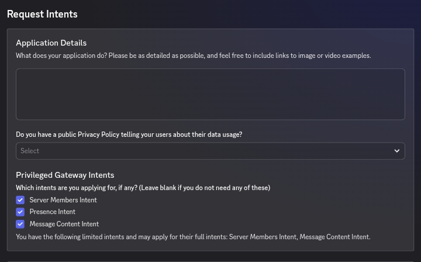
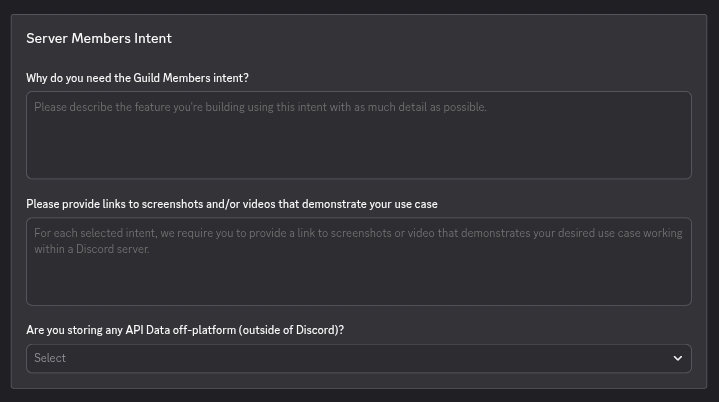
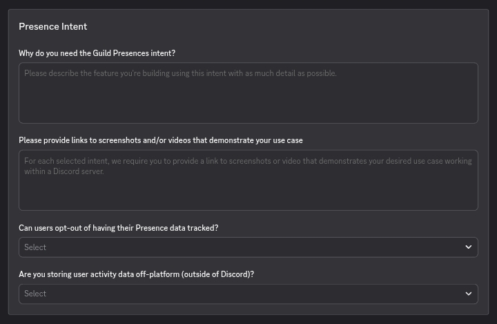
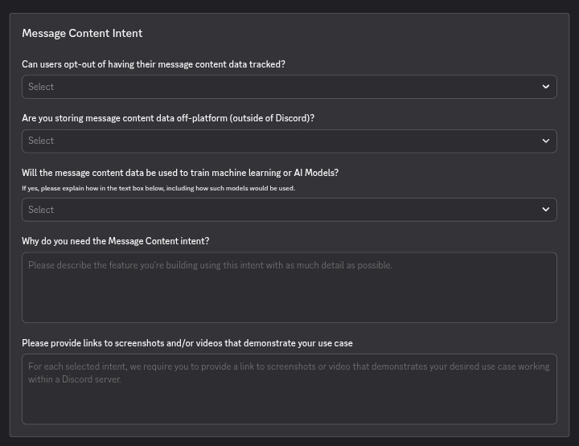

# 07 — Submission Evidence & Form

> A strong request proves necessity with a small, reproducible evidence packet. It does not rely on a clever phrase or a screenshot of a portal toggle.

---

## Supplied Developer Portal examples

The attached images show the intent-request form and the follow-up questions Discord may present. They are references for the shape of the form, not guaranteed wording:

### Request Intents overview

This screen asks for the application description, privacy-policy availability, and the privileged intents being requested.

### Guild Members intent

Explain the feature that uses member data, provide live screenshots or video links, and answer whether API data is stored off-platform.

### Guild Presences intent

Explain why individual presence data is needed, whether users can opt out, and whether activity data is stored outside Discord.

### Message Content intent

Address opt-out, off-platform storage, any ML/AI use, the exact feature need, and the evidence showing the feature in a Discord server.

> Before submitting, replace example links with accessible, current evidence. Redact tokens, private keys, personal information, and unrelated user data.

## Evidence packet

Prepare:

- a one-paragraph product description;
- an intent-to-feature matrix;
- exact events and fields used;
- alternatives considered and why they fail;
- a short recording of the live feature;
- screenshots of the user-facing setting that activates it;
- a privacy-policy link explaining Discord data use;
- retention and deletion behavior;
- security controls and service providers if data leaves your infrastructure;
- the final minimal intent list; and
- a migration plan for any old prefix or cache dependency.

The evidence should demonstrate **necessity**, not merely prove that the bot exists.

## Intent-to-feature matrix

| Requested intent | Feature | Event/fields | Alternative tested | Why it fails | Retention/security | Evidence |
|---|---|---|---|---|---|---|
| `GUILD_MEMBERS` | `[name]` | `[event or operation]` | `[lookup/search/interaction]` | `[specific gap]` | `[lifecycle]` | `[URL]` |
| `GUILD_PRESENCES` | `[name]` | `PRESENCE_UPDATE: [fields]` | `[aggregate/explicit action]` | `[specific gap]` | `[lifecycle]` | `[URL]` |
| `MESSAGE_CONTENT` | `[name]` | `[content fields]` | `[command/component/modal]` | `[specific gap]` | `[lifecycle]` | `[URL]` |

Delete rows for intents that are not actually requested.

## Strong answer pattern

> We request **[one exact intent]** for **[named feature]**. When **[specific event/user action]** occurs, the app uses **[specific fields]** to produce **[user-visible result]**. We tested **[alternative]**, but it cannot **[specific capability]**. We process only **[scope]**, retain **[minimal derived data or none]** for **[period]**, delete it by **[mechanism]**, restrict access to **[roles/services]**, and do not use it for unrelated analytics, advertising, scraping, profiling, or prohibited AI/ML training. The attached recording shows **[trigger]** and **[result]**.

This is a recommended structure inferred from Discord’s criteria, not guaranteed wording.

## Consistency review

Before submission, compare:

- the application page;
- installation context, scopes, and normal permissions;
- commands and user-facing settings;
- privacy policy;
- logs and stored fields;
- the intent request; and
- screenshots/video.

Contradictions—such as a privacy page saying “no message storage” while the app stores full message logs—create avoidable review risk.

## Key takeaway

Give a reviewer the shortest path from trigger to data to user-visible result, then make the lifecycle and evidence easy to verify.